# M.A.G.N.U.S. — Unified Project

A self-hosted companion suite for a **Fallout-themed, Italian-language tabletop RPG**.
One backend, one database, three front-ends: a game-master backoffice, an in-fiction RobCo
terminal emulator the players actually "sit down at", and a Pip-Boy character sheet that
runs on a phone at the table.

Everything is in one repo, deployed as one Docker stack, and specified with
[OpenSpec](#spec-driven-workflow) before it is written.

| App | What it is | Who uses it |
|---|---|---|
| **API** | NestJS + MongoDB backend — the single source of truth | everything |
| **CMS** | Angular backoffice: campaigns, terminals, map, catalogs, users | the game master |
| **Emulator** | Vanilla-JS RobCo terminal PWA with CRT phosphor, typing and sound | the players, in fiction |
| **Pip-Boy** | Vanilla-JS character-sheet PWA with dice roller and world map | the players, at the table |

---

## Screenshots

> All shots below are the real apps running against a mocked API — no live campaign data.

### Pip-Boy — the character sheet

<p align="center">
  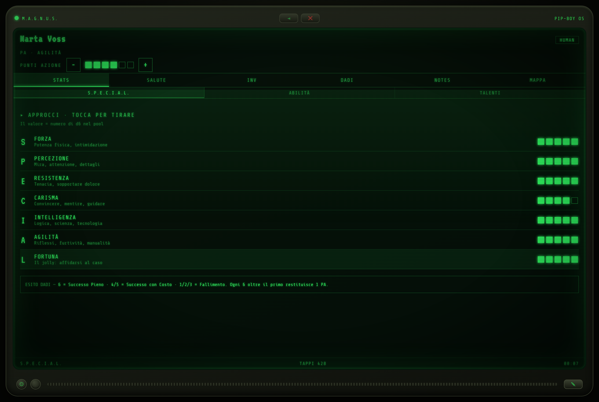
</p>

| Inventory | Notes |
|---|---|
| 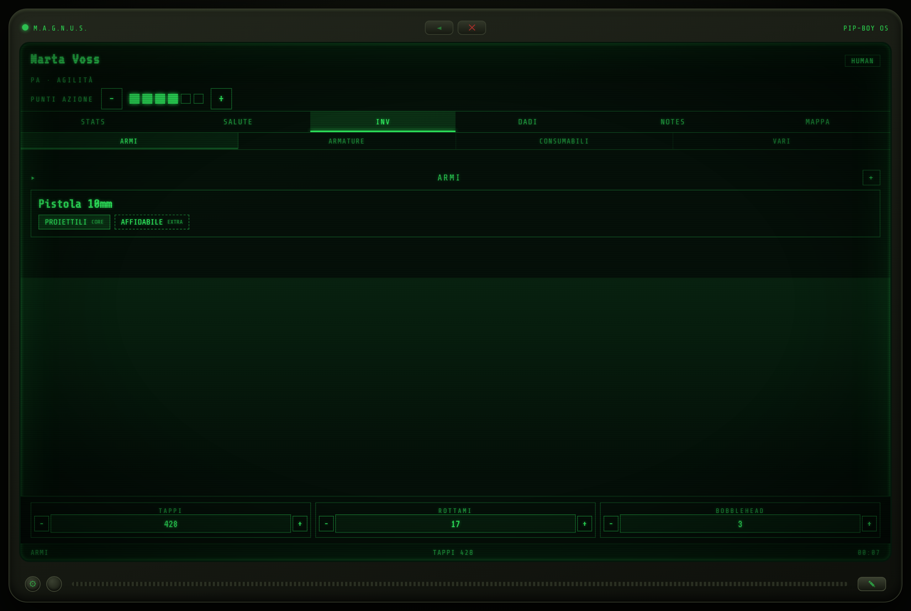 | 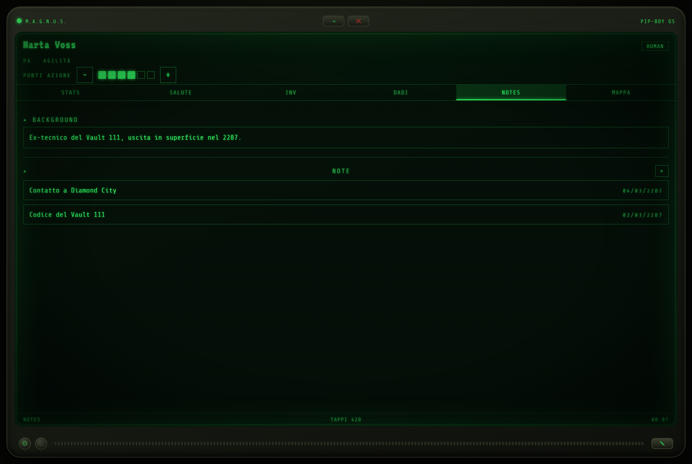 |

| Health & conditions | Dice roller |
|---|---|
| 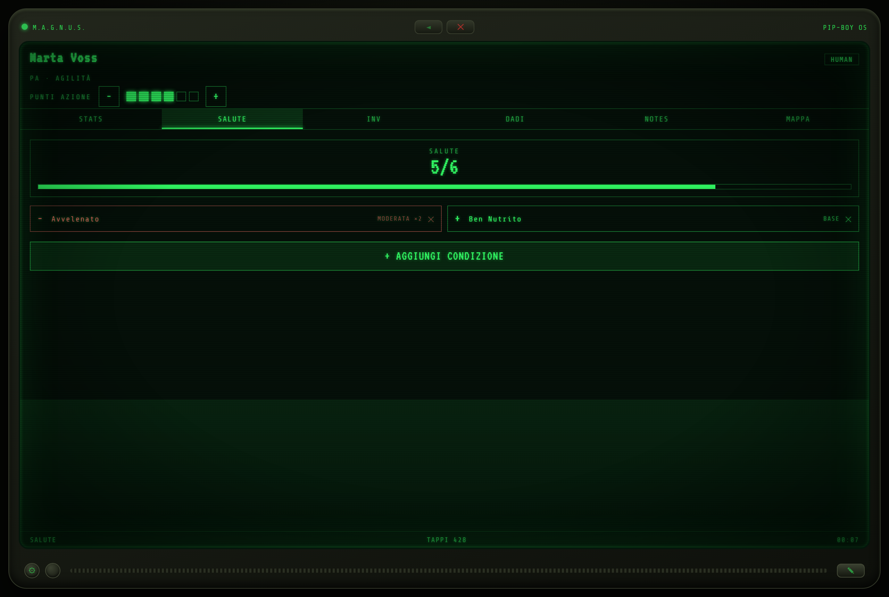 | 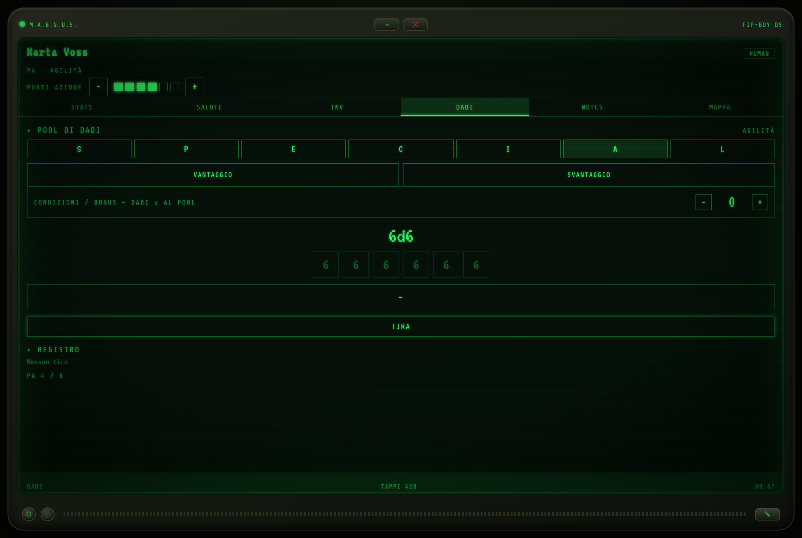 |

### The map

The campaign map is authored once in the CMS and rendered twice: as an editable Leaflet
canvas for the game master, and as a green-phosphor world map inside the Pip-Boy, where
places appear and disappear with zoom (level of detail) and only the public ones are ever
sent to a player.

<p align="center">
  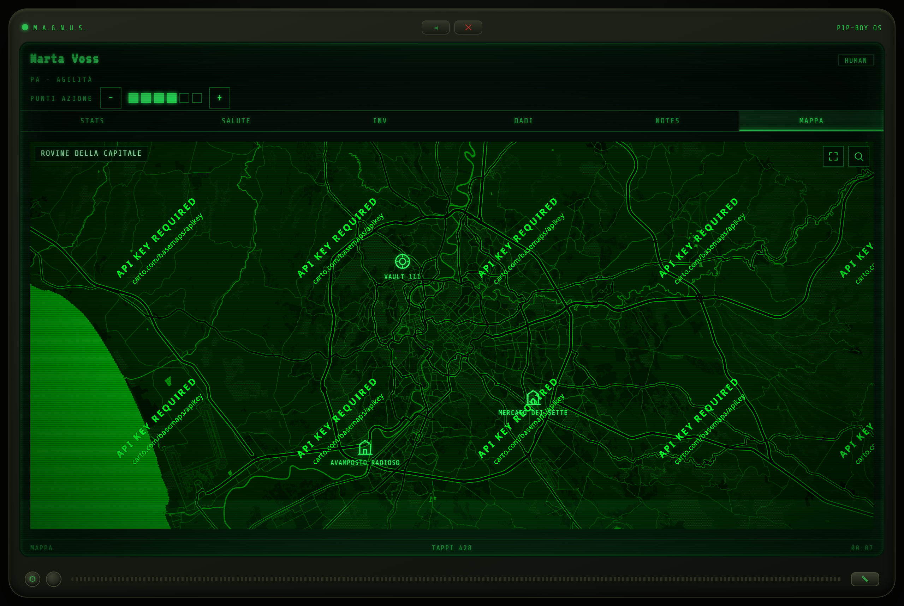
</p>

<p align="center">
  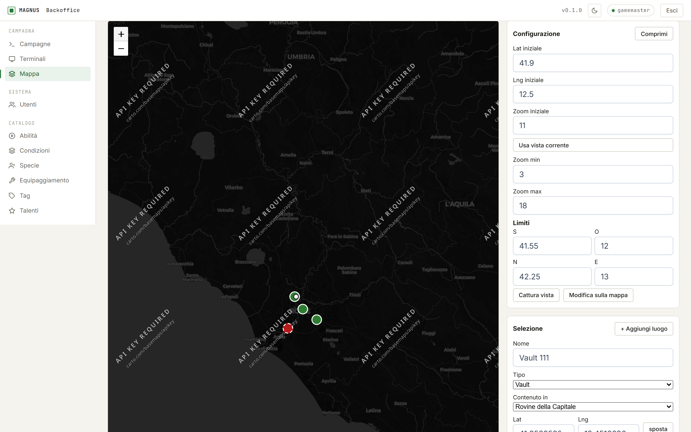
</p>

### Emulator — the in-fiction terminal

| Campaign selection | Terminal list |
|---|---|
| 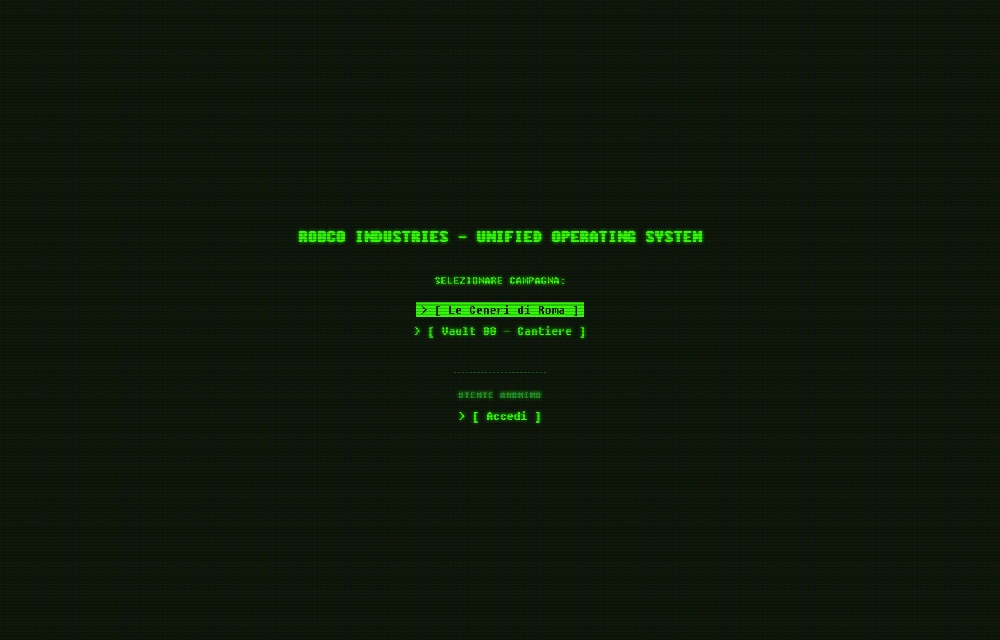 | 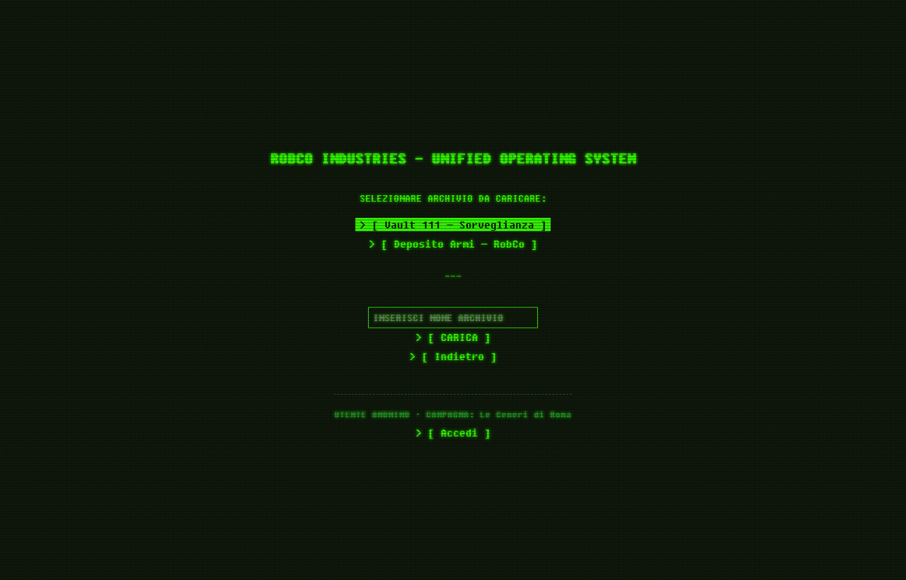 |

<p align="center">
  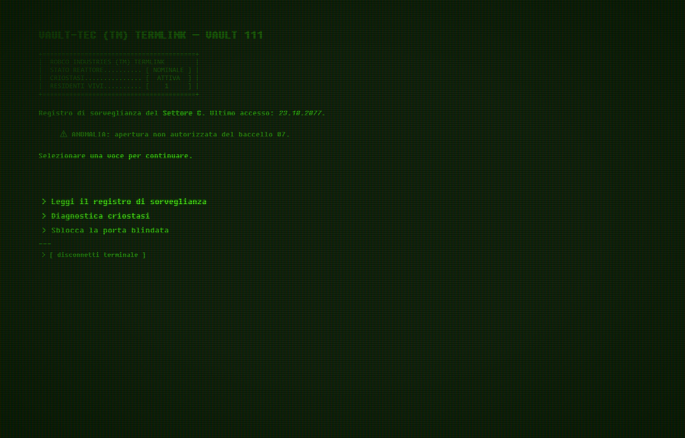
</p>

### CMS — the backoffice

<p align="center">
  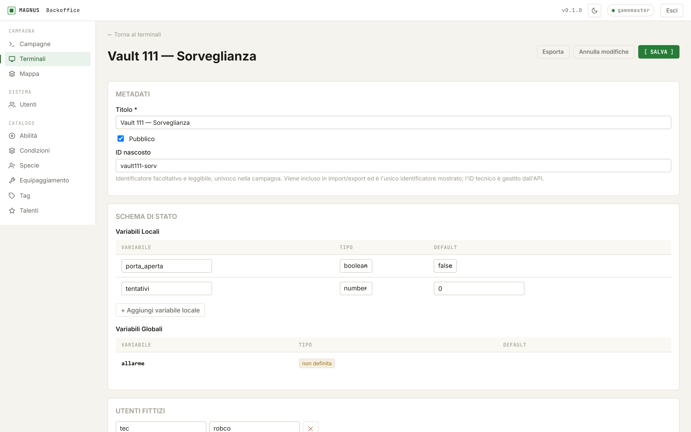
</p>

The editor derives a **flow map** from the terminal's node graph — entry node, choice edges,
input branches, and broken targets — so a branching script can be checked at a glance:

<p align="center">
  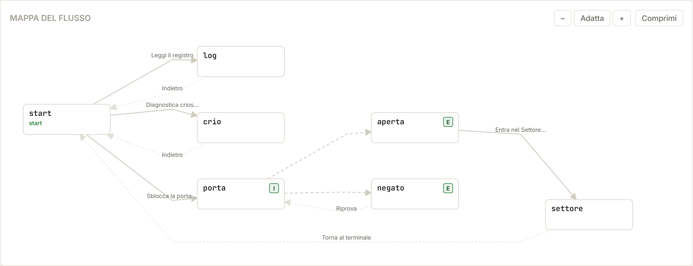
</p>

| Terminals | Campaigns |
|---|---|
| 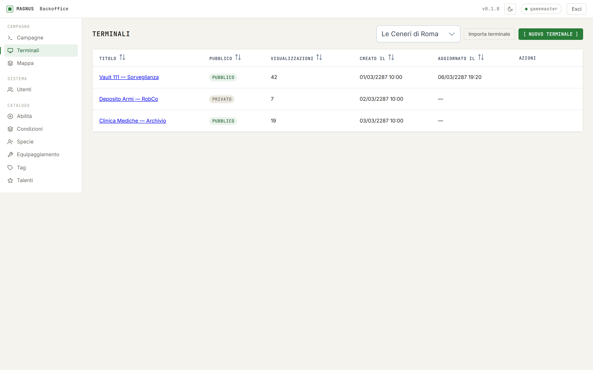 | 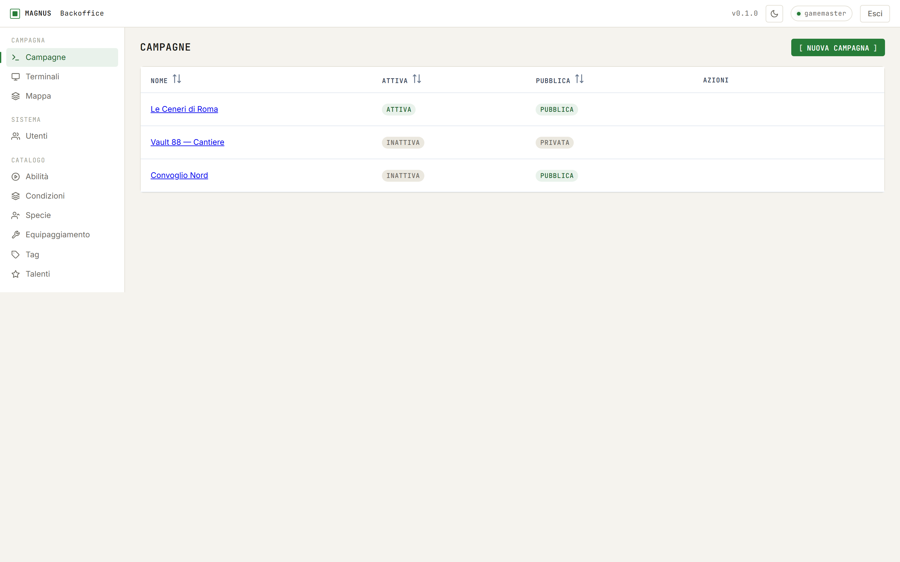 |

| Users | Game-data catalogs |
|---|---|
| 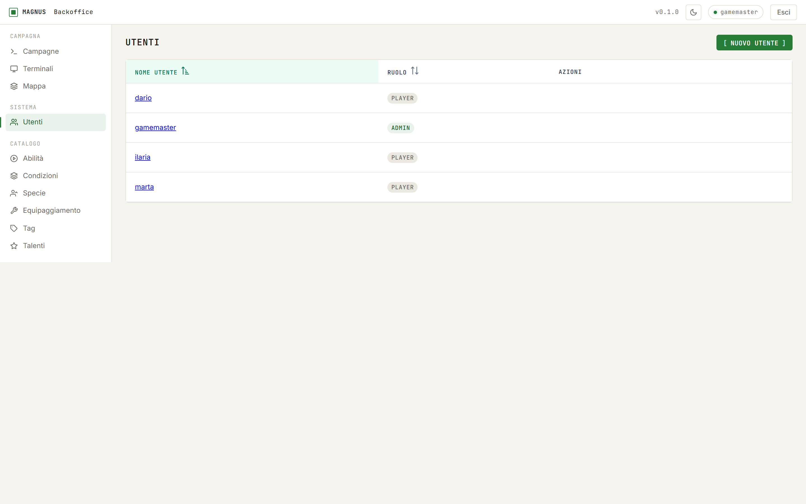 | 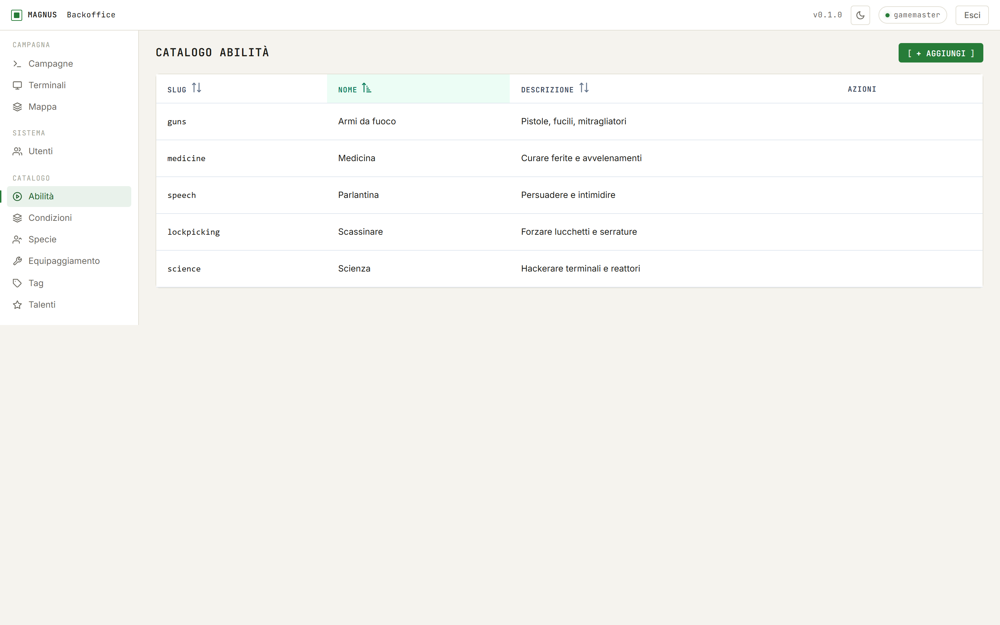 |

---

## Architecture

Every app is a separate container. Nothing publishes an application port: all traffic
arrives through a shared, host-level **Caddy** edge proxy, and each front-end calls the API
at the relative path **`/api`** on its own origin — same-origin, so there is no CORS to
configure.

```
                       internet  :80 / :443
                              │
                     ┌────────▼────────┐    imports deploy/magnus.caddy
                     │   Caddy (edge)  │
                     └────────┬────────┘
                              │  docker network "edge"
        ┌─────────────────────┼──────────────────────┬──────────────────┐
        │                     │                      │                  │
  cms.<BASE_HOST>     terminal.<BASE_HOST>    pipboy.<BASE_HOST>     /api/*  on
  ┌───────────┐        ┌──────────────┐       ┌──────────────┐       any host
  │ magnus-cms│        │magnus-terminal│      │ magnus-pipboy│          │
  │  (nginx)  │        │   (nginx)     │      │   (nginx)    │          │
  └───────────┘        └──────────────┘       └──────────────┘          │
                                                             ┌──────────▼─────────┐
                                                             │     magnus-api     │
                                                             │ NestJS on Fastify  │
                                                             └──────────┬─────────┘
                                                                        │ network "internal"
                                                             ┌──────────▼─────────┐
                                                             │    magnus-mongo    │
                                                             │  (loopback only)   │
                                                             └────────────────────┘
```

**Shape of a request.** A player opens `pipboy.<BASE_HOST>`, the PWA boots from its service
worker cache, authenticates with `POST /api/auth/login`, and from then on every read and
write is a JWT-bearing call to the same origin. The API is the only component that talks to
MongoDB; the front-ends never share state with each other except through it.

**Two PWAs, no build step.** The emulator and the Pip-Boy are hand-written ES modules served
as static files — no bundler, no transpilation, no framework. Their Docker images stamp a
`BUILD_ID` (the deployed commit's short SHA) into `sw.js`, so the service-worker cache
version changes exactly when the code does and installed clients self-heal instead of
serving a stale app forever.

---

## Technology stack

| Layer | Stack |
|---|---|
| **API** (`apps/api/api`) | NestJS 11 on **Fastify**, Mongoose 9 / MongoDB 7, Passport-JWT auth, `class-validator` DTOs, Helmet, Swagger (`/docs`, also emitted to `apps/packages/api-spec/openapi.json`), Jest unit + e2e (e2e runs against `mongodb-memory-server`, no external DB) |
| **CMS** (`apps/cms`) | Angular 21 (standalone components, signals, lazy routes), PrimeNG 21 + Tailwind, `zod` schemas for every authored shape, `dagre` for flow-graph layout, Leaflet for the map editor, `ngx-markdown`, types generated from the OpenAPI spec (`npm run api:gen`), Vitest/jsdom unit tests with a 70 % line-coverage gate |
| **Emulator** (`apps/terminal`) | Vanilla HTML5 / CSS3 / ES modules, zero dependencies, `marked` from CDN, custom CRT engine (phosphor wave, scanlines, typewriter, WebAudio SFX), PWA + service worker, nginx image, Playwright e2e |
| **Pip-Boy** (`apps/pip-boy`) | Vanilla ES modules, vendored Leaflet, client-side dice engine, an entry-capped service-worker cache for basemap tiles, PWA + service worker (wake lock, orientation lock, haptics), nginx image, Playwright e2e |
| **Infra** | Docker Compose, nginx per front-end, shared external `edge` network, Caddy edge proxy (Let's Encrypt in prod, internal CA locally), `nip.io` wildcard hostnames |
| **Process** | OpenSpec spec-driven workflow (`openspec/`), Claude Code / opencode skills in `.claude/` and `.opencode/` |

---

## Modules

### API — `apps/api/api`

Each folder under `src/` is a NestJS module with its own schemas, DTOs, controller and service.

| Module | Responsibility |
|---|---|
| `auth` | Login, logout, `/auth/me`, JWT issuance, role guards (`admin` / `player`) |
| `users` | User CRUD, password reset, per-user last-selection and unlocked hidden terminals |
| `campaigns` | Campaigns, player assignments, public/active flags, **global** state variables |
| `terminals` | Terminal documents (the branching JSON "olonastri"), import/export, hidden-id lookup, playback `load` endpoint, view counting |
| `state` | The state engine: embedded `{ type, value, default }` maps, `set` / `increment` / `toggle` mutations, schema-driven validation, variable- and scope-level reset, atomic multi-mutation requests |
| `characters` | Characters and their sections — S.P.E.C.I.A.L., skills, talents, status/conditions, action points, resources, inventory, notes, background — each patched through its own endpoint; also the generated **personal terminal** (a read-only terminal payload derived live from a character, shape-compatible with normal playback) |
| `campaign-map` | Authored places (slug, type, coordinates, radius, parent, visibility) plus view config; projects a player-safe subset, cascading `isPublic` down the containment tree |
| `skills-catalog`, `conditions-catalog`, `species-catalog`, `equipment-catalog`, `tag-catalog`, `talents-catalog` | Global, non-campaign-scoped game-data catalogs: readable by any authenticated user, batch-editable by admins |
| `configuration` | Shared service behind the per-user and per-campaign client configuration endpoints (CRT preferences and friends), mounted by `users` and `campaigns` |
| `health`, `common` | Health probe, request-logging middleware, exception filter, guards, shared utils |

### CMS — `apps/cms`

Routes are lazy-loaded and role-gated; the catalogs and the map are admin-only because the
API rejects non-admin writes to them anyway.

- **Campaign workspace** — a campaign switcher backed by `CurrentCampaignService`; everything
  else in the app is scoped to the selected campaign.
- **Campaigns** — CRUD, player assignments, global state schema, state viewer/editor and
  reset operations.
- **Terminals** — list, create, import/export JSON, and a full editor: metadata, state
  schema, fictional-user logins, recursive node/choice/variant/condition/mutation editors,
  and the derived flow graph.
- **Campaign map** — Leaflet authoring surface: place a point, set type/radius/parent,
  toggle player visibility, preview the Pip-Boy's visibility filter, import/export places.
- **Users** — CRUD, role assignment, password reset.
- **Catalogs** — skills, conditions, species, equipment, tags, talents.

### Emulator — `apps/terminal`

- **Screens** — campaign selection, terminal list (boot screen), the terminal itself,
  fictional login (in-world credentials), real user login, options, and the CRT wave tuner.
- **Engine** — typewriter with fast-replay, node resolver (variants, conditions, mutations),
  input components, back-history, keyboard navigation, hidden-terminal access by code,
  sound effects, CRT controls and the phosphor-wave renderer.
- **State** — a single in-memory `{ local, global }` store seeded from the playback envelope;
  no module keeps a parallel copy.
- **Personal terminal** — an authenticated player can open their own character as a terminal,
  generated server-side from live character data.

### Pip-Boy — `apps/pip-boy`

- **Screens** — login, campaign select, character select (dossier cards), character creation
  wizard, and the sheet.
- **Tabs** — `STATS` (S.P.E.C.I.A.L. approaches, abilities, talents), `SALUTE` (conditions and
  margin), `INV` (weapons, armour, consumables, misc, with a catalog-backed add-item popup),
  `DADI` (d6-pool roller with tumble animation), `NOTES` (background + Markdown notes with an
  in-place editor), `MAPPA` (the world map).
- **Engine** — device integration (wake lock, orientation lock, vibration), theme, chrome,
  dice, settings popup.
- **Map** — Leaflet over a dark CARTO basemap under a phosphor filter, containment-based level
  of detail, breadcrumb of the current zone, search, fullscreen, and a capped tile cache.

### Extras

- `scripts/radio-mixdown` — a standalone Python/`uv` tool that welds an opening/mid/closing
  clip trio into a single in-universe old-timey radio recap (bandpass, mono downmix,
  compression, hiss, crackle, saturation), with a Gradio playground for tuning presets.
- `reference/` — authoring guides for the AI agents that write terminal content and import
  map locations, plus the game manual.

---

## Spec-driven workflow

Specifications live in `openspec/` and are the contract the code is written against:

- `openspec/specs/<capability>/spec.md` — the current, agreed behaviour of one capability.
  Capabilities are prefixed by the app that owns them: `api-*`, `cms-*`, `emulator-*`,
  `pipboy-*`, `deploy-*`.
- `openspec/changes/<change>/` — proposals in flight; archived under `changes/archive/` once
  applied.
- `openspec/config.yaml` — the house rules. Notably: every proposal must name its tests and
  the layer they run at, every behaviour change must ship a paired test, and **a change
  cannot be archived while any test is red** (API ≥ 80 % lines on changed files, CMS ≥ 70 %,
  emulator and Pip-Boy verified by Playwright against the real DOM).

The `/opsx:propose → /opsx:apply → /opsx:archive` skills in `.claude/` and `.opencode/` drive
that loop.

---

## Running it

### Locally

```bash
docker network create edge          # once — the shared proxy network
cp docker-compose.override.yml.example docker-compose.override.yml   # optional: live-edit the PWAs
docker compose up -d --build
```

| App | URL |
|---|---|
| CMS | <https://cms.127.0.0.1.nip.io/> |
| Emulator | <https://terminal.127.0.0.1.nip.io/> |
| Pip-Boy | <https://pipboy.127.0.0.1.nip.io/> |
| API | `/api` on any host above · Swagger at `/api/docs` |
| MongoDB | `mongodb://localhost:27017` (loopback only) |

Local TLS uses Caddy's internal CA, so the first visit shows a certificate warning until you
trust its root — see [`URLS.md`](URLS.md) for the one-liner. `BASE_HOST` in the root `.env` is
the only thing that differs between local and the server.

Create the first admin with `npm run bootstrap:admin` in `apps/api/api`.

### Per-app development

```bash
# API
cd apps/api/api && npm install && npm run start:dev
npm test && npm run test:e2e

# CMS
cd apps/cms && npm install && npm start        # http://localhost:4200
npm test                                        # Vitest, jsdom, coverage gate

# Emulator / Pip-Boy — static; the suites serve them over a bundled static server
cd apps/terminal && npm install && npx playwright install chromium && npm test
cd apps/pip-boy  && npm test
```

The PWAs are image-built (their SW cache version is stamped at build time), so a bare source
edit does not show up in a running container — either `docker compose up -d --build pip-boy`
or use the git-ignored `docker-compose.override.yml` to mount the sources for live editing.

### Deploying

```bash
./deploy.sh        # from your machine: SSHes to the server and runs start.sh for your branch
```

`start.sh` runs on the server: it fetches, checks out and pulls the branch, exports
`BUILD_ID` from the deployed commit, and rebuilds the stack. Routing details and the one-time
host proxy setup are in [`deploy/README.md`](deploy/README.md) and
[`deploy/edge-proxy-host-runbook.md`](deploy/edge-proxy-host-runbook.md).

---

## Repository layout

```
apps/
  api/api/        NestJS backend (src/<module>/{controller,service,schemas,dto})
  cms/            Angular backoffice (src/app/{core,features,layout,domain})
  terminal/       RobCo terminal emulator PWA (src/{screens,engine,state,api})
  pip-boy/        Pip-Boy character-sheet PWA (src/{screens,tabs,sheet,engine,state,api})
  packages/
    api-spec/     openapi.json, emitted by the API in development
deploy/           Caddy snippet, runbook, smoke test
docs/screenshots/ the images in this README
openspec/         specs/, changes/, config.yaml — the spec-driven workflow
reference/        authoring guides for terminal content and map imports, game manual
scripts/
  radio-mixdown/  standalone Python tool for in-universe radio recaps
docker-compose.yml, start.sh, deploy.sh, URLS.md
```
